# TeamPeric Dienstleistungen – Logo-Entwürfe

## Neue Entwürfe für Website und WhatsApp (`neu/`)

| Ordner | Inhalt |
|---|---|
| `neu/website/` | Logo mit transparentem Hintergrund |
| `neu/whatsapp/` | Quadratisches Profilbild (1024 × 1024), passt in den runden Ausschnitt |
| `neu/original/` | Unbearbeitete KI-Ausgabe |

### A Stahlträger
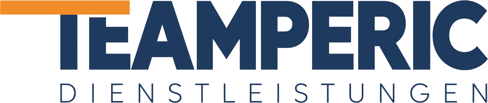

### B Hexagon
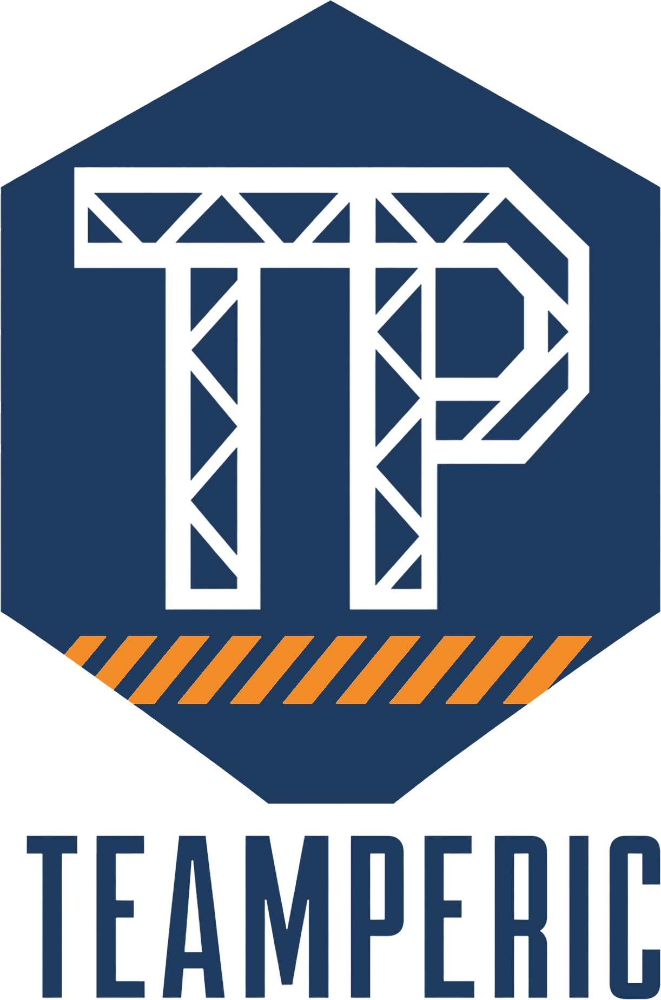

### C Module
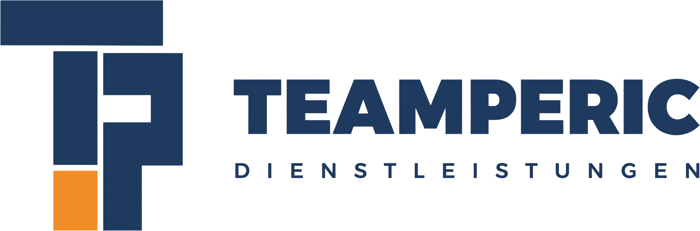

## Schwarz-Weiß-Entwürfe (`schwarz_weiss/`)

| Ordner | Inhalt | Wofür |
|---|---|---|
| `weiss_hintergrund/` | Schwarz auf Weiß | Druck, Dokumente |
| `schwarz_transparent/` | Schwarz, transparent | Helle Jacken und Flächen |
| `weiss_transparent/` | Weiß, transparent | Dunkle Jacken und Flächen |
| `original/` | Unbearbeitete KI-Ausgabe | Archiv |

### SW A Module
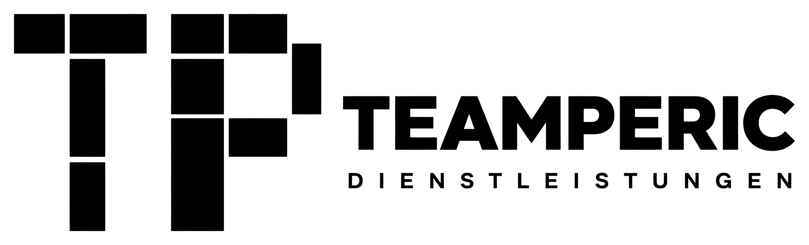

### SW B Hexagon
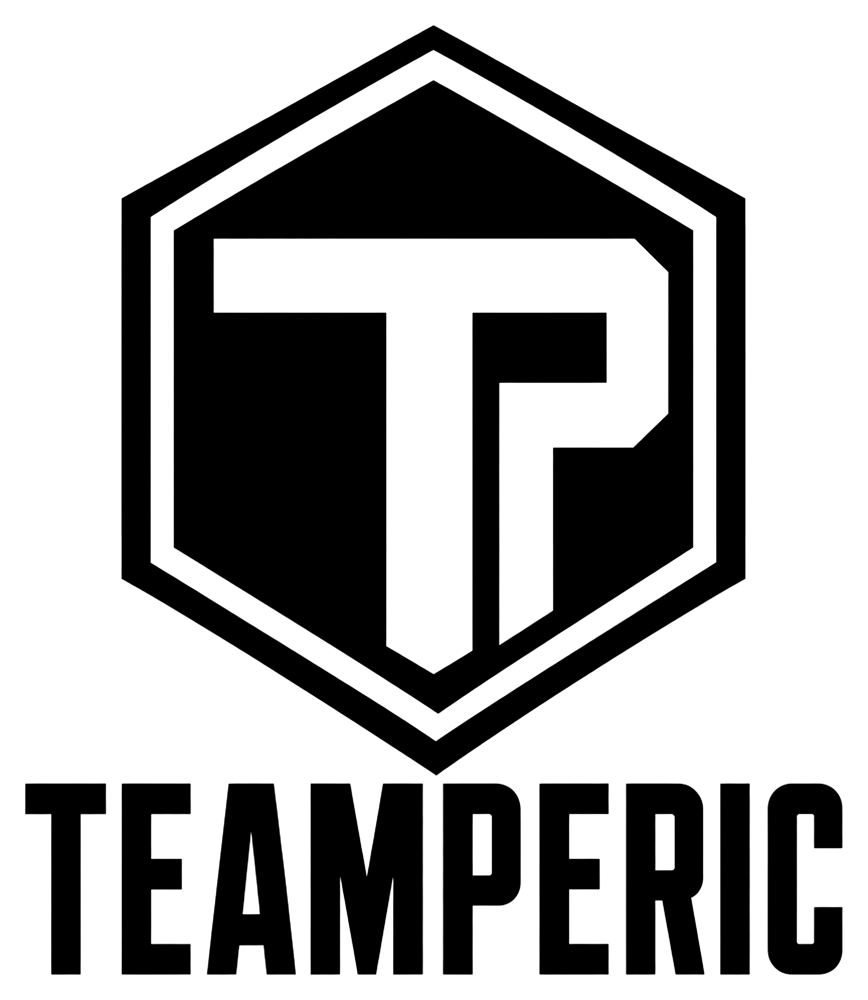

### SW C Stahlträger
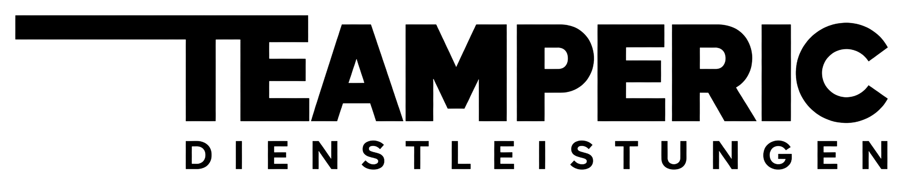

## Erste Runde

Fünf frühere Entwürfe, jeder in denselben Varianten.

| Ordner | Inhalt | Wofür |
|---|---|---|
| `logo/` | Farbig auf Weiß | Dokumente, Angebote, allgemeine Nutzung |
| `website/` | Farbig, transparenter Hintergrund | Website, Header |
| `jacke/` | Einfarbig: `_navy` für helle, `_weiss` für dunkle Stoffe | Jacken, T-Shirts, Fahrzeuge |
| `original/` | Unbearbeitete KI-Ausgabe (1024 × 1024) | Archiv |

Farben: Navy `#1F3A5F`, Orange `#F28C28`, Weiß.

Die Dateien sind PNGs. Für Stick oder Fahrzeugbeschriftung braucht der Betrieb den gewählten Entwurf als Vektordatei.

## Entwürfe

### 01 TP-Monogramm
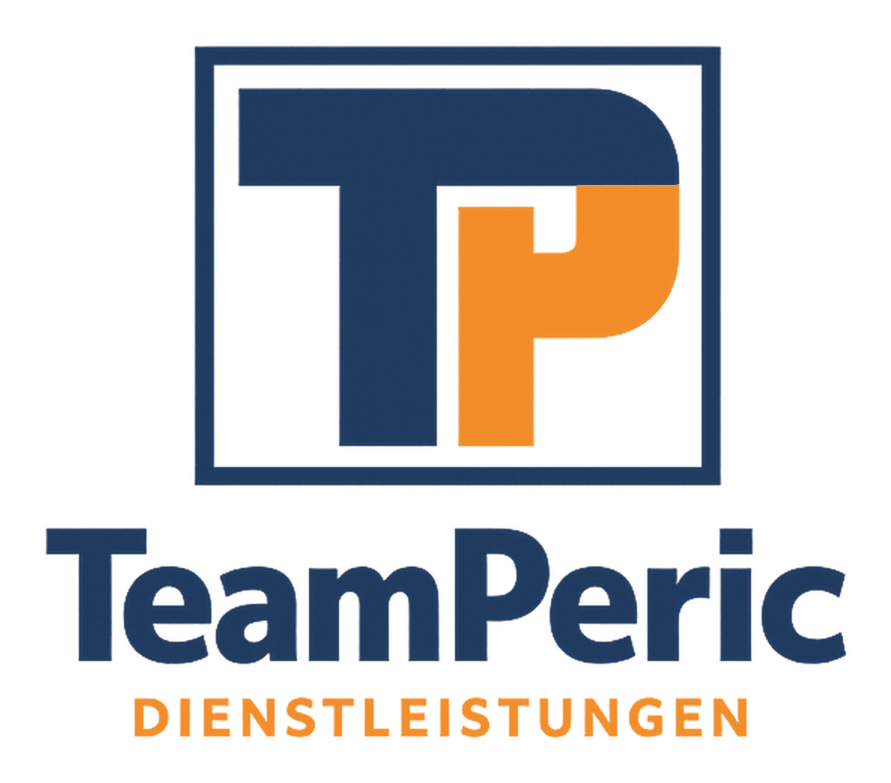

### 02 Container-Module
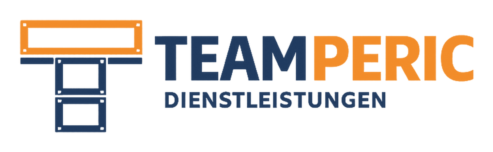

### 03 Bausteine
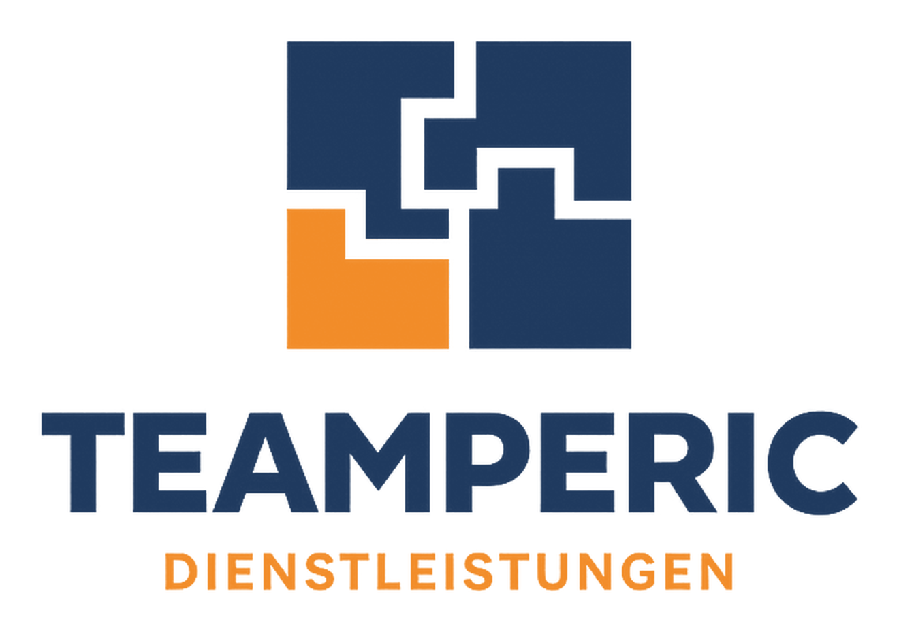

### 04 Wappen
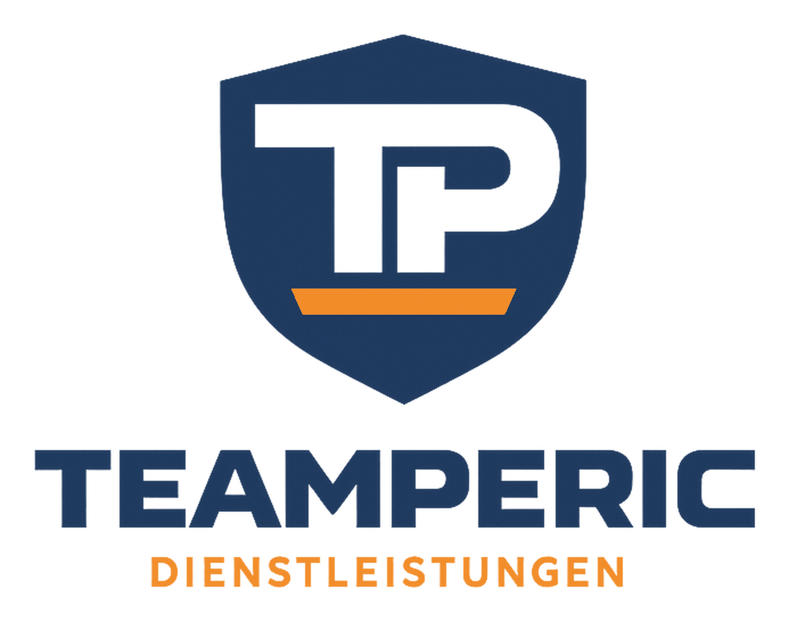

### 05 Messestand-Rahmen
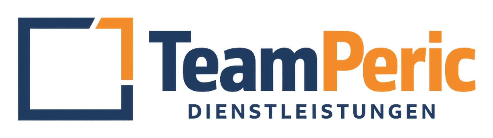
